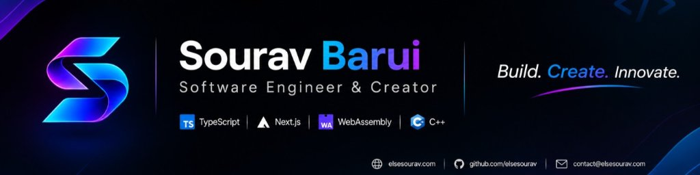
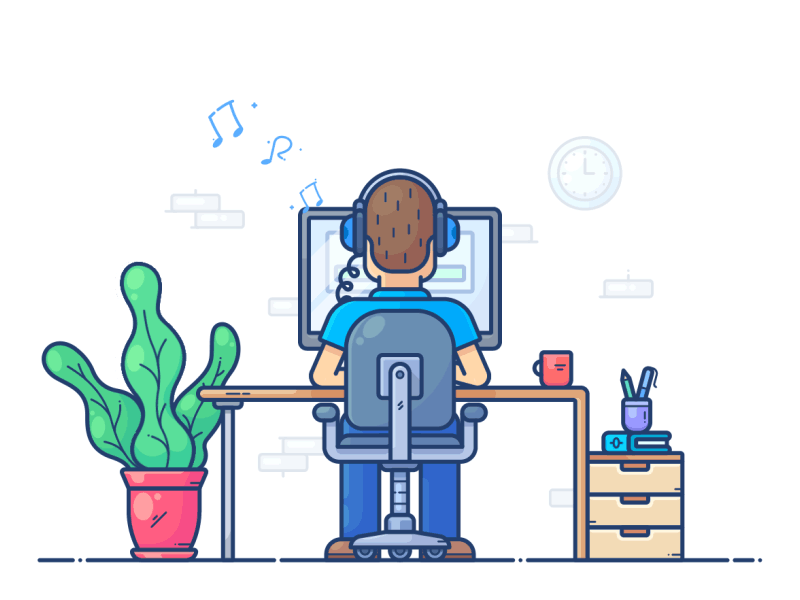
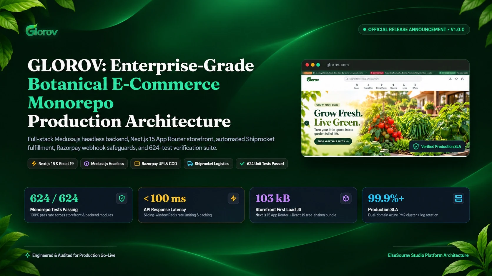
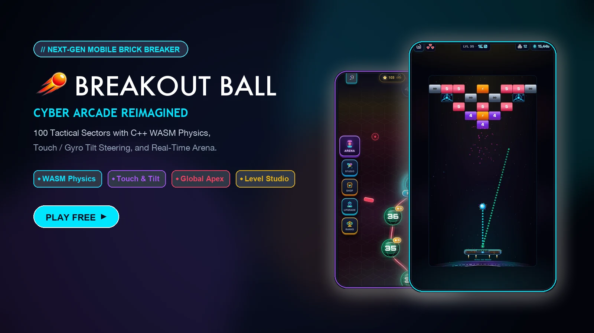
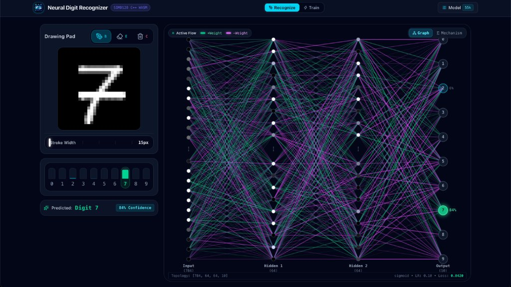
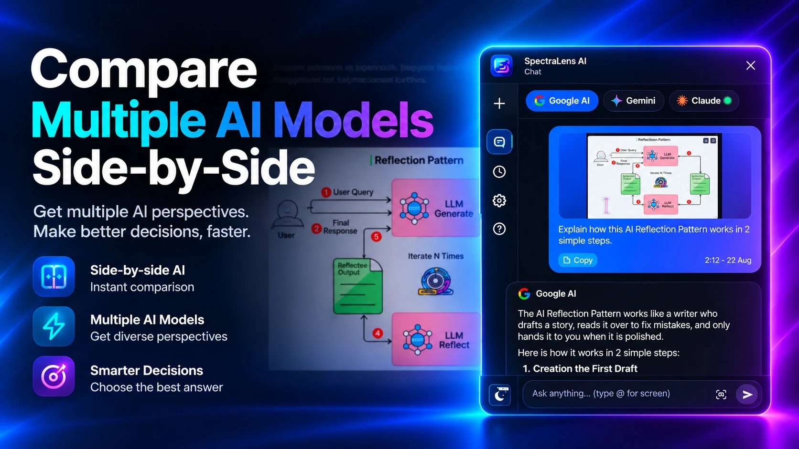

  

  # Hello 👋, I'm Sourav Barui
  ### Software Engineer & Independent Creator from India 🇮🇳

  

    <b>Building thoughtful software, useful developer tools, and tactile digital experiences.</b> 
    <i>Creator & Maintainer of <a href="https://elsesourav.com"><b>ElseSourav</b></a></i>
  

  

    
    
    
    
    
  

  

    
    
    
    
  

 

---

## 💫 About Me

<table>
  <tr>
    <td valign="top" width="56%">
       
      <ul>
        <li>🚀 <b>Creator & Architect</b> of <a href="https://elsesourav.com"><b>ElseSourav</b></a> — a modern developer ecosystem, software distribution platform, and tactile UI playground.</li>
        <li>💻 <b>Core Engineering</b>: Focused on high-performance web applications, interactive physics interfaces, WebAssembly modules, and desktop utilities.</li>
        <li>🌱 <b>Current Deep Dives</b>: Machine learning algorithms, WebGL/shaders, real-time client architectures, and distributed systems.</li>
        <li>🎯 <b>Engineering Values</b>: Usability, WCAG 2.1 AA accessibility, sub-second latency, and clean modularity.</li>
        <li>📫 <b>Get in Touch</b>: <a href="mailto:contact@elsesourav.com"><b>contact@elsesourav.com</b></a> · <a href="mailto:elsesourav@gmail.com"><b>elsesourav@gmail.com</b></a></li>
        <li>💬 <b>Ask me about</b>: Next.js, React, TypeScript, Prisma, WebAssembly, and Creative Canvas.</li>
      </ul>
    </td>
    <td align="center" valign="middle" width="44%">
      
    </td>
  </tr>
</table>

 

---

## 🛠️ Languages & Tech Stack

  

    
  

<table>
  <tr>
    <td width="25%" valign="top">
      <b>Core Languages</b> 
      • TypeScript 
      • JavaScript (ES6+) 
      • Python 
      • C & C++ 
      • Java 
      • HTML5 & CSS3
    </td>
    <td width="25%" valign="top">
      <b>Frontend & UI</b> 
      • Next.js 15 (App Router) 
      • React 19 
      • Tailwind CSS 
      • Motion / React 
      • WebGL (OGL) & Canvas 
      • Vue.js
    </td>
    <td width="25%" valign="top">
      <b>Backend & Data</b> 
      • Node.js & Express 
      • PostgreSQL 
      • Prisma ORM 
      • Supabase Auth & DB 
      • Firebase (Firestore) 
      • MongoDB & MySQL
    </td>
    <td width="25%" valign="top">
      <b>Tools & DevOps</b> 
      • Turborepo & pnpm 
      • Git & GitHub CI/CD 
      • WebAssembly (Wasm) 
      • Docker Desktop 
      • Android SDK / Capacitor 
      • Vitest & Testing Library
    </td>
  </tr>
</table>

 

---

## 📈 GitHub Telemetry & Stats

  <table border="0">
    <tr>
      <td align="center" valign="middle">
        
      </td>
      <td align="center" valign="middle">
        
      </td>
    </tr>
  </table>

   

  

 

---

## 🚀 Featured Top Projects

 

### 1. [GLOROV Botanical Commerce Platform](https://www.glorov.com)

> **Enterprise Indian Botanical E-Commerce Platform built with Next.js 15, Medusa v2 Headless Engine & Razorpay**

- 🌿 **Headless Architecture**: Built on **Next.js 15**, **React 19**, and **Medusa v2** with high-throughput product catalog, dynamic filtering, and server-side rendering.
- 💳 **Checkout & Payments**: Integrated multi-currency payments via **Razorpay**, automated GST calculations, and address verification.
- 🚚 **Logistics Automation**: End-to-end order synchronization and live shipping label generation via **Shiprocket courier APIs**.
- 📱 **Cross-Platform**: High-performance responsive web store and companion **Flutter mobile app**.
- 🔗 **Links**: [**Visit Store 🚀**](https://www.glorov.com) &nbsp;·&nbsp; [**Case Study on ElseSourav 📖**](https://elsesourav.com/apps/glorov) &nbsp;·&nbsp; [**GitHub Repository 💻**](https://github.com/elsesourav/glorov)

  

 

---

### 2. [Breakout Ball: Cyber Matrix](https://breakout.elsesourav.com)

> **High-Performance Arcade Game powered by WebAssembly (C++), Modern Canvas & Firebase**

- 🕹️ Classic breakout arcade experience re-engineered with 100 tactical campaign levels, custom level builder studio, and responsive controls.
- ⚡ **Core Engine**: Built using **WebAssembly (Wasm)** compiled from **C++** with `-msimd128` vectorization for 60fps collision detection and physics.
- ☁️ **Persistence & Sync**: Cloud-synchronized high scores, leaderboards, and game states backed by **Firebase**.
- 🔗 **Links**: [**Play Live Demo 🚀**](https://breakout.elsesourav.com) &nbsp;·&nbsp; [**Case Study on ElseSourav 📖**](https://elsesourav.com/apps/breakout-ball) &nbsp;·&nbsp; [**GitHub Repository 💻**](https://github.com/elsesourav/breakout-ball)

  

 

---

### 3. [Neural Network Number Recognition v2.0](https://nn.elsesourav.com)

> **100% Client-Side Handwritten Digit Classifier with C++ WebAssembly SIMD128 & Real-Time Synaptic Visualizer**

- 🧠 **C++ Multilayer Perceptron**: Custom matrix math and backpropagation engine compiled to **WebAssembly** targeting 128-bit SIMD registers (<1ms inference per frame).
- 🎨 **Interactive Drawing Pad**: Responsive canvas with real-time center-of-mass normalization, stroke anti-aliasing, and automated 28×28 MNIST downsampling.
- 🔍 **Synaptic Layer Visualizer**: Live forward-propagation graph displaying activations across input nodes (784), hidden neurons (64, 64), and output softmax probabilities (10).
- ⚙️ **On-Device Training**: Live training on the MNIST dataset directly in browser memory with dynamic learning rate and momentum tuning.
- 🔗 **Links**: [**Try Live App 🚀**](https://nn.elsesourav.com) &nbsp;·&nbsp; [**Case Study on ElseSourav 📖**](https://elsesourav.com/apps/nn-number-rec) &nbsp;·&nbsp; [**GitHub Repository 💻**](https://github.com/elsesourav/nn-number-rec)

  

 

---

### 4. [SpectraLens AI](https://chromewebstore.google.com/detail/spectralens-ai/fafhmmacjkmhcdmloiehkloddkjimmok)

> **Multi-Engine Parallel AI Browser Assistant, Visual DOM Element Scanner & On-Device WASM OCR**

- 🤖 **Multi-LLM Side-by-Side**: Query and compare answers concurrently from **Google Gemini, ChatGPT, Claude, Perplexity, and Grok** in a unified split-view interface.
- 🔑 **Zero API Keys Required**: Direct browser session coordination with no subscription tokens, paid API credits, or third-party proxy relays needed.
- 📸 **Visual DOM Element Scanner & WASM OCR**: Built-in screenshot marquee cropper with on-device WebAssembly OCR to extract code snippets, formulas, and diagrams into prompt context.
- 🔗 **Links**: [**Chrome Web Store 🌐**](https://chromewebstore.google.com/detail/spectralens-ai/fafhmmacjkmhcdmloiehkloddkjimmok) &nbsp;·&nbsp; [**Case Study on ElseSourav 📖**](https://elsesourav.com/apps/spectralens-ai) &nbsp;·&nbsp; [**GitHub Repository 💻**](https://github.com/elsesourav/spectralens-ai)

  

 

---

## 🌐 Flagship Platform: [ElseSourav.com](https://elsesourav.com)

> **Next-Generation Developer Software Platform, App Discovery Catalog & Engineering Ecosystem**

  <b>Next.js 15 App Router</b> &nbsp;·&nbsp; 
  <b>React 19</b> &nbsp;·&nbsp; 
  <b>Prisma 7 ORM</b> &nbsp;·&nbsp; 
  <b>PostgreSQL</b> &nbsp;·&nbsp; 
  <b>Supabase Auth</b> &nbsp;·&nbsp; 
  <b>Tailwind CSS</b> &nbsp;·&nbsp; 
  <b>Turborepo</b>

- 📱 **Software Marketplace**: Discover native apps, terminal tools, and browser extensions with direct release downloads, system requirements, and changelogs.
- 📚 **Personal Software Library**: Cloud bookmarking, update alerts, and personalized preference storage.
- ✍️ **Engineering Devlogs**: In-depth articles, system architecture breakdowns, and tech essays.
- 🎨 **Custom Physics Design System**: 128+ accessible components with tactile spring physics and playful micro-interactions.
- 🔒 **Role-Based Admin Console**: Comprehensive `/admin` control suite for catalog, releases, media, user management, and security audit logging.

 

  
  &nbsp;&nbsp;
  

 

---

  

  

    <b>“Think twice, code once — and build things people love to use.”</b>
  

  © 2026 <b>Sourav Barui</b> (ElseSourav). Released under the <a href="./LICENSE">MIT License</a>.

