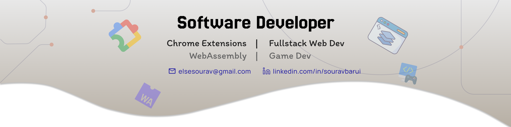
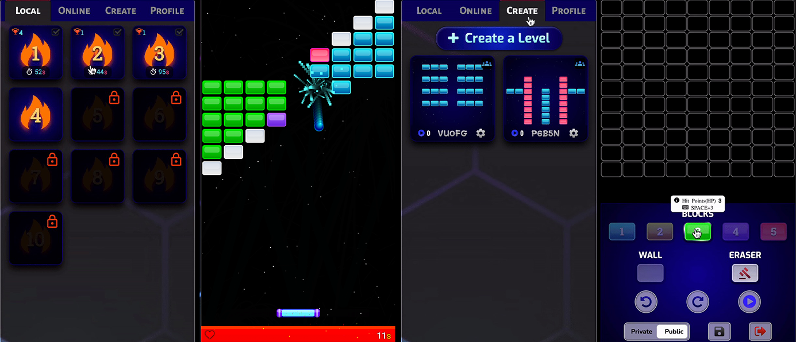
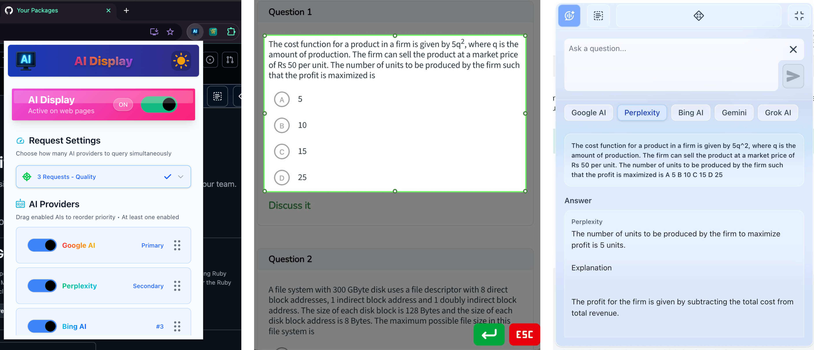
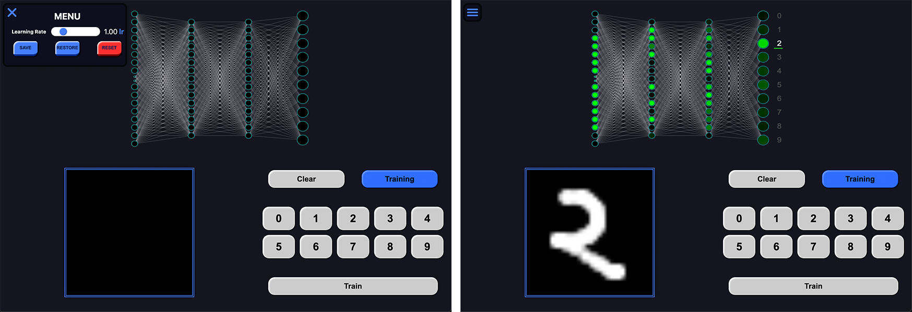
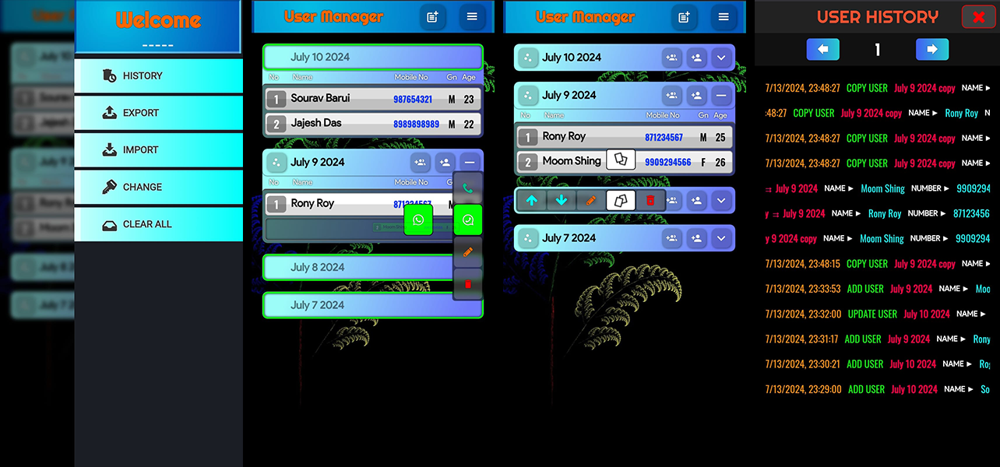

  

  # Hello 👋, I'm Sourav Barui
  ### Software Engineer & Independent Creator from India 🇮🇳

  

    <b>Building thoughtful software, useful developer tools, and tactile digital experiences.</b> 
    <i>Creator & Maintainer of <a href="https://elsesourav.com"><b>ElseSourav</b></a></i>
  

  

    
    
    
    
    
  

  

    
    
    
    
  

 

---

## 💫 About Me

<table>
  <tr>
    <td valign="top" width="56%">
       
      <ul>
        <li>🚀 <b>Creator & Architect</b> of <a href="https://elsesourav.com"><b>ElseSourav</b></a> — a modern developer ecosystem, software distribution platform, and tactile UI playground.</li>
        <li>💻 <b>Core Engineering</b>: Focused on high-performance web applications, interactive physics interfaces, WebAssembly modules, and desktop utilities.</li>
        <li>🌱 <b>Current Deep Dives</b>: Machine learning algorithms, WebGL/shaders, real-time client architectures, and distributed systems.</li>
        <li>🎯 <b>Engineering Values</b>: Usability, WCAG 2.1 AA accessibility, sub-second latency, and clean modularity.</li>
        <li>📫 <b>Get in Touch</b>: <a href="mailto:contact@elsesourav.com"><b>contact@elsesourav.com</b></a> · <a href="mailto:elsesourav@gmail.com"><b>elsesourav@gmail.com</b></a></li>
        <li>💬 <b>Ask me about</b>: Next.js, React, TypeScript, Prisma, WebAssembly, and Creative Canvas.</li>
      </ul>
    </td>
    <td align="center" valign="middle" width="44%">
      
    </td>
  </tr>
</table>

 

---

## 🛠️ Languages & Tech Stack

  

    
  

<table>
  <tr>
    <td width="25%" valign="top">
      <b>Core Languages</b> 
      • TypeScript 
      • JavaScript (ES6+) 
      • Python 
      • C & C++ 
      • Java 
      • HTML5 & CSS3
    </td>
    <td width="25%" valign="top">
      <b>Frontend & UI</b> 
      • Next.js 15 (App Router) 
      • React 19 
      • Tailwind CSS 
      • Motion / React 
      • WebGL (OGL) & Canvas 
      • Vue.js
    </td>
    <td width="25%" valign="top">
      <b>Backend & Data</b> 
      • Node.js & Express 
      • PostgreSQL 
      • Prisma ORM 
      • Supabase Auth & DB 
      • Firebase (Firestore) 
      • MongoDB & MySQL
    </td>
    <td width="25%" valign="top">
      <b>Tools & DevOps</b> 
      • Turborepo & pnpm 
      • Git & GitHub CI/CD 
      • WebAssembly (Wasm) 
      • Docker Desktop 
      • Android SDK / Capacitor 
      • Vitest & Testing Library
    </td>
  </tr>
</table>

 

---

## 📈 GitHub Telemetry & Stats

  <table border="0">
    <tr>
      <td align="center" valign="middle">
        
      </td>
      <td align="center" valign="middle">
        
      </td>
    </tr>
  </table>

   

  

 

---

## 🚀 Featured Top Projects

 

### 1. [Breakout Ball Game](https://elsesourav.github.io/breakout-ball/)

> **High-Performance Arcade Game powered by WebAssembly (C++), Modern Canvas & Firebase**

- 🕹️ Classic breakout arcade experience re-engineered with modern physics and responsive controls.
- ⚡ **Core Engine**: Built using **WebAssembly (Wasm)** compiled from **C++** for optimal 60fps collision detection and rendering.
- ☁️ **Persistence**: Cloud-synchronized high scores, leaderboards, and game states backed by **Firebase**.
- 🔗 **Links**: [**Play Live Demo 🚀**](https://elsesourav.github.io/breakout-ball/) &nbsp;·&nbsp; [**GitHub Repository 💻**](https://github.com/elsesourav/breakout-ball)

  

 

---

### 2. [AI Display](https://github.com/elsesourav/ai-display)

> **All-in-One Multi-LLM Chrome Extension with Side-by-Side Comparison & Offline OCR**

- 🤖 Access and compare answers simultaneously from **Google Gemini, Bing AI / Copilot, Perplexity, Grok**, and other frontier models in a single unified dashboard.
- 🔑 **Zero API Keys Required**: Seamless browser session integration with no paid API keys or subscription tokens needed.
- 📸 **Screen Cropper & OCR**: Built-in screenshot marquee tool with client-side OCR for extracting text and formulas directly from any web page into prompts.
- 🔗 **Links**: [**Download Extension (.zip) 📦**](https://github.com/elsesourav/ai-display/raw/main/ai-display-extension.zip) &nbsp;·&nbsp; [**GitHub Repository 💻**](https://github.com/elsesourav/ai-display)

  

 

---

### 3. [Neural Network Number Recognition](https://elsesourav.github.io/nn-number-rec/)

> **Interactive Handwritten Digit Classifier with Real-time Neural Layer Visualization**

- 🧠 Custom neural network trained in the browser to accurately identify handwritten numerical digits (0–9).
- 🎨 **Interactive Canvas**: Draw numbers on a responsive tactile grid with dynamic resolution preprocessing.
- 🔍 **Architecture Inspector**: Live visualization of forward-propagation across input nodes, hidden layers, activation functions, and output probabilities.
- ⚙️ **Hyperparameter Tuning**: Real-time learning rate adjustments, weight matrices export/import, and instant accuracy metrics.
- 🔗 **Links**: [**Try Neural Network 🚀**](https://elsesourav.github.io/nn-number-rec/) &nbsp;·&nbsp; [**GitHub Repository 💻**](https://github.com/elsesourav/nn-number-rec/)

  

 

---

### 4. [User Manager](https://elsesourav.github.io/user-manager/)

> **Cross-Platform Contact & Group Management System with Direct WhatsApp Actions**

- 👥 Intuitive user management platform designed for direct sales, network marketing, and client coordination.
- 🔀 **Drag & Drop Organization**: Smooth categorization of leads and members into customizable tiers and teams.
- 💬 **WhatsApp Automation**: Single-click trigger to initiate chats with target users directly without saving phone numbers manually.
- 📱 **Multi-Platform**: Packaged and optimized for responsive web, desktop browsers, and Android mobile environments.
- 🔗 **Links**: [**Launch User Manager 🚀**](https://elsesourav.github.io/user-manager/) &nbsp;·&nbsp; [**GitHub Repository 💻**](https://github.com/elsesourav/user-manager/)

  

 

---

## 🌐 Flagship Platform: [ElseSourav.com](https://elsesourav.com)

> **Next-Generation Developer Software Platform, App Discovery Catalog & Engineering Ecosystem**

  <b>Next.js 15 App Router</b> &nbsp;·&nbsp; 
  <b>React 19</b> &nbsp;·&nbsp; 
  <b>Prisma 7 ORM</b> &nbsp;·&nbsp; 
  <b>PostgreSQL</b> &nbsp;·&nbsp; 
  <b>Supabase Auth</b> &nbsp;·&nbsp; 
  <b>Tailwind CSS</b> &nbsp;·&nbsp; 
  <b>Turborepo</b>

- 📱 **Software Marketplace**: Discover native apps, terminal tools, and browser extensions with direct release downloads, system requirements, and changelogs.
- 📚 **Personal Software Library**: Cloud bookmarking, update alerts, and personalized preference storage.
- ✍️ **Engineering Devlogs**: In-depth articles, system architecture breakdowns, and tech essays.
- 🎨 **Custom Physics Design System**: 128+ accessible components with tactile spring physics and playful micro-interactions.
- 🔒 **Role-Based Admin Console**: Comprehensive `/admin` control suite for catalog, releases, media, user management, and security audit logging.

 

  
  &nbsp;&nbsp;
  

 

---

  

  

    <b>“Think twice, code once — and build things people love to use.”</b>
  

  © 2026 <b>Sourav Barui</b> (ElseSourav). Released under the <a href="./LICENSE">MIT License</a>.

