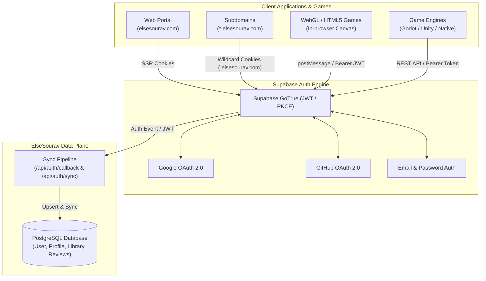
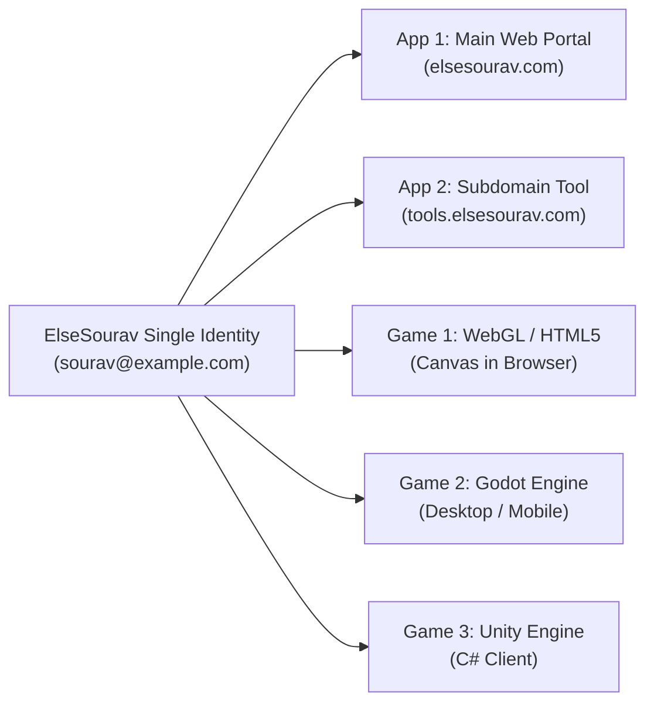
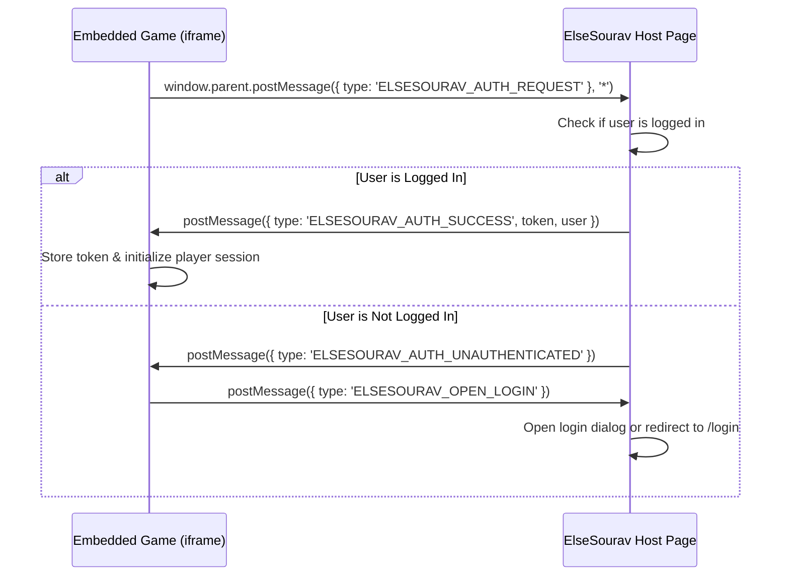
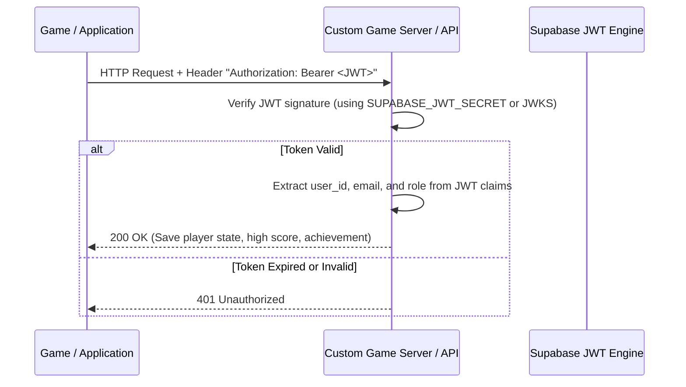

# ElseSourav Universal Authentication & Ecosystem Integration Guide

> **Authoritative Specification & Cross-Platform Developer Reference**  
> Covers: Google OAuth, GitHub OAuth, Email/Password, Single Sign-On (SSO), Component Inventory, and Game Engine Integration (Godot, Unity, WebGL).

---

## 1. System Architecture & Identity Core

ElseSourav utilizes a **dual-tier, unified identity system** where authentication credentials and security sessions are managed by **Supabase Auth** (GoTrue / PKCE / JWT) while rich user profiles, application libraries, preferences, and platform permissions are synchronized to a **PostgreSQL database managed via Prisma ORM**.



### Key Principles

1. **One Account Everywhere**: A user registers once (via Google, GitHub, or Email/Username) and retains the exact same identity, avatar, preferences, and saved library across all ElseSourav web apps, subdomains, tools, and native games.
2. **Stateless JWT Verification**: Any service or game backend can verify an ElseSourav session without making roundtrip database queries simply by verifying the cryptographic signature of the Supabase JWT.
3. **Automatic Profile Synchronization**: Whenever an OAuth user signs in, their avatar, display name, and provider data are immediately mirrored to the internal PostgreSQL `User` record.
4. **Role-Based Access Control (RBAC)**: Supports three standard roles:
   - `USER`: Default member with access to personal library, preferences, profile settings, and public tools.
   - `STAFF`: Elevated team member for support triage and content moderation.
   - `ADMIN`: Administrator with access to the CMS, settings, audit logs, and media engine.

---

## 2. Available Sign-Up & Sign-In Services

ElseSourav provides three primary authentication methods:

| Service | Protocol | Key Features | Primary Component |
| :--- | :--- | :--- | :--- |
| **Google** | OAuth 2.0 / OIDC | One-click login, automatic Google profile photo import, zero password fatigue | `<OAuthButtons />` |
| **GitHub** | OAuth 2.0 | One-click developer login, imports GitHub handle and avatar | `<OAuthButtons />` |
| **Email & Password** | Supabase Auth + Bcrypt | Multi-step progressive registration, live username availability check, username suggestions | `<SignUpForm />` |
| **Username Sign-In** | Custom Resolver + Supabase | Allows signing in with either `@username` or email address | `<LoginForm />` |
| **Password Recovery** | 6-Digit OTP Protocol | Self-service password reset with email verification code | `<ForgotPasswordForm />` |

---

## 3. Reusable UI Component Inventory

All authentication components are modular, fully accessible (WCAG AA), responsive, and styled according to the ElseSourav design system.

### Component Summary Table

| Component | Location | Description | Key Props |
| :--- | :--- | :--- | :--- |
| **`LoginForm`** | `apps/web/components/auth/LoginForm.tsx` | Complete sign-in form supporting OAuth + Email/Username | `isAdmin?: boolean`, `defaultRedirect?: string` |
| **`SignUpForm`** | `apps/web/components/auth/SignUpForm.tsx` | Two-step progressive sign-up with live username check | None (self-contained with URL query detection) |
| **`OAuthButtons`** | `apps/web/components/auth/OAuthButtons.tsx` | Side-by-side Google & GitHub authentication buttons | `redirectTo?: string`, `onError?: (err: string) => void` |
| **`ForgotPasswordForm`** | `apps/web/components/auth/ForgotPasswordForm.tsx` | 3-step OTP password recovery flow | None |
| **`OtpBoxes`** | `apps/web/components/auth/OtpBoxes.tsx` | 6-digit accessible OTP digit inputs with paste handling | `value: string`, `onChange: (val: string) => void`, `disabled?: boolean` |
| **`UserAvatarMenu`** | `apps/web/features/user/components/UserAvatarMenu.tsx` | Floating profile menu with avatar, status, and links | `user: AuthenticatedUser` |
| **`UserNav`** | `apps/web/features/user/components/UserNav.tsx` | Navigation shell for authenticated user areas | `user?: AuthenticatedUser \| null` |
| **`MobileBottomNav`** | `apps/web/components/navigation/MobileBottomNav.tsx` | Responsive bottom navigation bar with active route glow | `user?: AuthenticatedUser \| null` |

---

### Component Integration Examples

#### 1. Embedding OAuth Buttons

To embed Google and GitHub sign-in buttons inside any page or modal:

```tsx
'use client';

import { OAuthButtons } from '@/components/auth/OAuthButtons';

export function QuickSocialAuth({ nextUrl = '/dashboard' }: { nextUrl?: string }) {
  return (
    <div className="w-full max-w-sm space-y-3">
      <p className="text-xs text-muted-foreground text-center">
        Sign in with your preferred provider:
      </p>
      <OAuthButtons
        redirectTo={nextUrl}
        onError={(errMsg) => console.error('OAuth error:', errMsg)}
      />
    </div>
  );
}
```

#### 2. Embedding the Full Login Form

```tsx
'use client';

import { LoginForm } from '@/components/auth/LoginForm';

export function AuthModalContent() {
  return (
    <div className="p-4 bg-surface rounded-2xl border border-border">
      <LoginForm
        isAdmin={false}
        defaultRedirect="/account"
      />
    </div>
  );
}
```

#### 3. Displaying Authenticated User Avatar & Dropdown

```tsx
import { cookies } from 'next/headers';
import { getServerSession } from '@elsesourav/auth';
import { UserAvatarMenu } from '@/features/user/components/UserAvatarMenu';
import Link from 'next/link';

export async function SiteHeaderAuth() {
  const cookieStore = await cookies();
  const session = await getServerSession({
    getAll: () => cookieStore.getAll(),
  });

  if (!session?.user) {
    return (
      <Link
        href="/login"
        className="px-3.5 py-1.5 text-xs font-semibold rounded-xl bg-primary text-white hover:bg-primary/90 transition-colors"
      >
        Sign In
      </Link>
    );
  }

  return <UserAvatarMenu user={session.user} />;
}
```

---

## 4. Single Sign-On (SSO) Across Multiple Applications & Games

This section outlines how different games, tools, and subdomains authenticate against the same ElseSourav account.



---

### Strategy A: Subdomains (`*.elsesourav.com`)

If your application runs on a subdomain (e.g., `arcade.elsesourav.com`, `notes.elsesourav.com`, `admin.elsesourav.com`), it can share the exact same session cookie as `elsesourav.com`.

#### Implementation:
When setting cookies in `@elsesourav/auth` or `@supabase/ssr`, configure the cookie domain to `.elsesourav.com` (with a leading dot).

```typescript
// packages/auth/src/server/server-client.ts or browser-client.ts
cookieOptions: {
  domain: process.env.NODE_ENV === 'production' ? '.elsesourav.com' : undefined,
  path: '/',
  sameSite: 'lax',
  secure: process.env.NODE_ENV === 'production',
  maxAge: 60 * 60 * 24 * 7, // 7 days
}
```

**Result**: A user who logs into `elsesourav.com` is automatically and instantly logged into every subdomain without entering credentials again.

---

### Strategy B: Embedded WebGL Games & HTML5 Canvases

For browser games embedded in an `<iframe>` or hosted under `elsesourav.com/apps/[slug]/play`:

#### 1. If Same Domain (`elsesourav.com`):
The game has direct access to the session cookie. All calls to `/api/apps/[slug]/feedback` or game backend endpoints automatically send the authentication cookie with `credentials: 'include'`:

```javascript
// Inside your HTML5/JavaScript game:
async function loadPlayerProfile() {
  const response = await fetch('/api/user/profile', {
    credentials: 'include', // Automatically passes the ElseSourav session cookie
  });
  if (response.ok) {
    const data = await response.json();
    console.log('Player identified:', data.user.displayName);
  }
}
```

#### 2. If Cross-Domain Iframe (`postMessage` Handshake Protocol):
When the game is hosted on a separate CDN or game host (e.g., itch.io, Cloudflare Pages, GitHub Pages) and embedded in an iframe:



**Host-side listener (on `elsesourav.com`):**
```typescript
// Inside apps/web/features/apps/components/GamePlayerFrame.tsx
useEffect(() => {
  const handleMessage = async (event: MessageEvent) => {
    // Only accept messages from verified game frame
    if (event.data?.type === 'ELSESOURAV_AUTH_REQUEST') {
      const session = await getClientSession();
      if (session?.accessToken) {
        event.source?.postMessage(
          {
            type: 'ELSESOURAV_AUTH_SUCCESS',
            accessToken: session.accessToken,
            user: session.user,
          },
          { targetOrigin: '*' }
        );
      } else {
        event.source?.postMessage(
          { type: 'ELSESOURAV_AUTH_UNAUTHENTICATED' },
          { targetOrigin: '*' }
        );
      }
    }
  };

  window.addEventListener('message', handleMessage);
  return () => window.removeEventListener('message', handleMessage);
}, []);
```

---

### Strategy C: Native Game Integration in Godot (4.x)

Godot games (desktop or mobile) can connect to the ElseSourav authentication backend using built-in `HTTPRequest` nodes to exchange email/password or refresh tokens for session JWTs.

#### Godot 4.x GDScript Authentication Manager (`AuthManager.gd`):

```gdscript
extends Node
class_name ElseSouravAuth

signal login_succeeded(user_data)
signal login_failed(error_message)

const SUPABASE_URL = "https://srfevooktrqjzjuddmko.supabase.co"
const SUPABASE_ANON_KEY = "YOUR_ANON_KEY_HERE"

var access_token: String = ""
var refresh_token: String = ""
var current_user: Dictionary = {}

var http_request: HTTPRequest

func _ready() -> void:
    http_request = HTTPRequest.new()
    add_child(http_request)
    http_request.request_completed.connect(_on_request_completed)
    _load_persisted_session()

## Sign in with ElseSourav account
func login_with_credentials(email: String, password: String) -> void:
    var url = SUPABASE_URL + "/auth/v1/token?grant_type=password"
    var headers = [
        "Content-Type: application/json",
        "apikey: " + SUPABASE_ANON_KEY
    ]
    var payload = JSON.stringify({
        "email": email,
        "password": password
    })
    
    var error = http_request.request(url, headers, HTTPClient.METHOD_POST, payload)
    if error != OK:
        emit_signal("login_failed", "Network request failed to initialize")

func _on_request_completed(result: int, response_code: int, headers: PackedStringArray, body: PackedByteArray) -> void:
    var response_text = body.get_string_from_utf8()
    var json = JSON.parse_string(response_text)
    
    if response_code == 200 and json is Dictionary:
        access_token = json.get("access_token", "")
        refresh_token = json.get("refresh_token", "")
        current_user = json.get("user", {})
        _save_session(access_token, refresh_token)
        emit_signal("login_succeeded", current_user)
    else:
        var msg = "Authentication failed"
        if json is Dictionary and json.has("error_description"):
            msg = json["error_description"]
        emit_signal("login_failed", msg)

## Save session securely on local disk
func _save_session(token: String, refresh: String) -> void:
    var config = ConfigFile.new()
    config.set_value("auth", "access_token", token)
    config.set_value("auth", "refresh_token", refresh)
    config.save_encrypted_pass("user://elsesourav_session.bin", "game_secret_salt")

## Load session on startup
func _load_persisted_session() -> void:
    var config = ConfigFile.new()
    var err = config.load_encrypted_pass("user://elsesourav_session.bin", "game_secret_salt")
    if err == OK:
        access_token = config.get_value("auth", "access_token", "")
        refresh_token = config.get_value("auth", "refresh_token", "")
```

---

### Strategy D: Native Game Integration in Unity (C#)

In Unity, use `supabase-csharp` or native `UnityWebRequest` to manage the player's account.

#### Unity C# Script (`ElseSouravAuthClient.cs`):

```csharp
using System;
using System.Text;
using System.Threading.Tasks;
using UnityEngine;
using UnityEngine.Networking;

[Serializable]
public class AuthResponse
{
    public string access_token;
    public string refresh_token;
    public UserData user;
}

[Serializable]
public class UserData
{
    public string id;
    public string email;
}

public class ElseSouravAuthClient : MonoBehaviour
{
    private const string SUPABASE_URL = "https://srfevooktrqjzjuddmko.supabase.co";
    private const string ANON_KEY = "YOUR_ANON_KEY_HERE";

    public static ElseSouravAuthClient Instance { get; private set; }
    public string AccessToken { get; private set; }
    public string PlayerId { get; private set; }

    private void Awake()
    {
        if (Instance == null) { Instance = this; DontDestroyOnLoad(gameObject); }
        else { Destroy(gameObject); }
    }

    public async Task<bool> SignInAsync(string email, string password)
    {
        string endpoint = $"{SUPABASE_URL}/auth/v1/token?grant_type=password";
        string jsonBody = $"{{\"email\":\"{email}\",\"password\":\"{password}\"}}";

        using (UnityWebRequest request = new UnityWebRequest(endpoint, "POST"))
        {
            byte[] bodyRaw = Encoding.UTF8.GetBytes(jsonBody);
            request.uploadHandler = new UploadHandlerRaw(bodyRaw);
            request.downloadHandler = new DownloadHandlerBuffer();
            request.SetRequestHeader("Content-Type", "application/json");
            request.SetRequestHeader("apikey", ANON_KEY);

            var operation = request.SendWebRequest();
            while (!operation.isDone) await Task.Yield();

            if (request.result == UnityWebRequest.Result.Success)
            {
                AuthResponse auth = JsonUtility.FromJson<AuthResponse>(request.downloadHandler.text);
                AccessToken = auth.access_token;
                PlayerId = auth.user.id;
                
                // Save access token securely in PlayerPrefs or Keychain
                PlayerPrefs.SetString("elsesourav_token", AccessToken);
                PlayerPrefs.Save();
                return true;
            }
            else
            {
                Debug.LogError($"Sign in error: {request.downloadHandler.text}");
                return false;
            }
        }
    }
}
```

---

### Strategy E: Game Backend & Microservice Token Verification

When your game makes requests to save high scores, submit reviews, or fetch user cloud saves, the backend service must verify the Supabase JWT.



#### Node.js / Express or Next.js Token Verification:

```typescript
import jwt from 'jsonwebtoken';

export function verifyElseSouravToken(authHeader?: string) {
  if (!authHeader?.startsWith('Bearer ')) {
    throw new Error('Missing or malformed Authorization header');
  }

  const token = authHeader.split(' ')[1];
  const jwtSecret = process.env.SUPABASE_JWT_SECRET!;

  // Verifies signature using HMAC SHA-256 and checks expiration
  const decoded = jwt.verify(token, jwtSecret) as {
    sub: string;       // User's unique UUID
    email: string;     // User's email
    role: string;      // Role
    exp: number;       // Expiration timestamp
  };

  return {
    userId: decoded.sub,
    email: decoded.email,
  };
}
```

---

## 5. Security & Verification Checklist

When building or integrating new applications into the ElseSourav ecosystem:

- [x] **Open-Redirect Hardening**: All OAuth flows and login forms sanitize the `next` or `redirect` query parameter via `sanitizeRedirectUrl` to prevent open-redirect attacks.
- [x] **Rate Limiting**: Authentication endpoints (`/api/auth/sync`, `/api/auth/resolve-identifier`, `/api/auth/forgot-password`) enforce strict IP-based rate limiting via `@elsesourav/utils` `checkRateLimit`.
- [x] **Honeypot Bot Protection**: Public registration forms feature hidden honeypot inputs and mount-time timers to reject automated spam bots.
- [x] **CSP Configuration**: Avatars from `lh3.googleusercontent.com` (Google) and `avatars.githubusercontent.com` (GitHub) are whitelisted in `apps/web/next.config.ts` Content Security Policy headers.
- [x] **Clean Public Surface**: Public login and signup sections never expose direct administrative links or internal operational portals.
