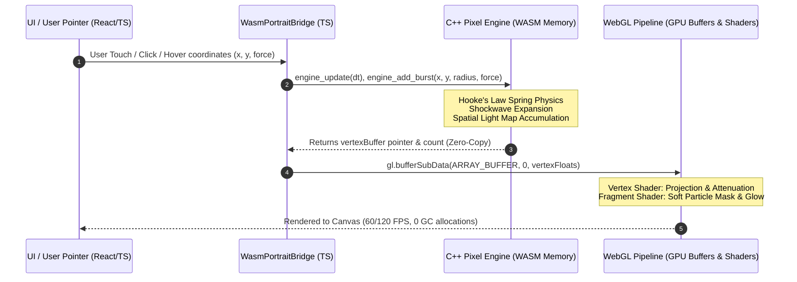
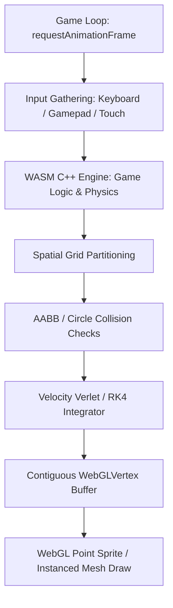

# Master Engineering Blueprint: High-Performance WebAssembly (WASM) & WebGL Interactive Graphics & Game Systems

> [!NOTE]
> This engineering blueprint documents the complete end-to-end architecture used to build the real-time interactive particle portrait in the **About Section** of ElseSourav. It provides a generalized, production-ready framework to architect, compile, and render high-performance simulations, interactive graphics, and 2D/3D games on the modern web using **C++**, **WebAssembly (Emscripten)**, and **WebGL/GLSL**.

---

## 1. System Architecture & High-Level Data Flow

Modern web applications often struggle with complex particle physics or collision detection in JavaScript due to single-threaded CPU contention and Garbage Collection (GC) pauses. By offloading intensive simulation math to **WebAssembly (compiled from C++)** and streaming vertex structures directly to **WebGL point sprites on the GPU**, we achieve locked 60/120 FPS performance with up to 200,000+ interactive entities.

### Core Data Flow Architecture



---

## 2. Toolchain & Environment Setup

To compile C++ code into WebAssembly without bloated Emscripten runtimes, we employ a **standalone WASM configuration** (`-sSTANDALONE_WASM=1 --no-entry`). This generates a pure `.wasm` binary that requires zero JavaScript glue code and can be embedded directly into TypeScript as a Base64 string for instantaneous, zero-network offline loading.

### Prerequisite Installations

On macOS / Linux:
```bash
# 1. Install Emscripten SDK via Homebrew (or git clone emsdk)
brew install emscripten

# 2. Verify emcc compiler is in PATH
emcc --version
# Expected: emcc (Emscripten gcc/clang-like replacement + LLVM) 3.1.x+

# 3. Python 3 (used for Base64 packaging)
python3 --version
```

### Directory Structure Blueprint

```
packages/graphics-engine/
├── cpp/
│   ├── engine.hpp            # Master engine class declaration
│   ├── engine.cpp            # Core update and lifecycle implementations
│   ├── particle.hpp          # Entity structures (Position, Velocity, Color, Mass)
│   ├── physics.hpp           # Vector math, spring forces, and collision solvers
│   ├── lighting.hpp          # Proximity light emitters & spatial accumulation
│   └── contour.hpp           # Edge detection and equidistant path resampling
├── scripts/
│   └── build.sh              # Automated compilation & TypeScript packager
└── src/
    ├── wasm_binary_bytes.ts   # Auto-generated Base64 / Uint8Array embedded module
    ├── engine.bridge.ts      # Zero-copy memory bridge & C-ABI bindings
    ├── engine.renderer.ts    # WebGL context, shaders, and draw calls
    └── EngineCanvas.tsx      # React/Next.js canvas mount & pointer listener
```

---

## 3. C++ Simulation Engine Design (Data-Oriented Architecture)

In high-performance simulations and games, object-oriented pointer hierarchies (`std::vector<Entity*>`) create cache misses and memory fragmentation. Instead, we use **Data-Oriented Design (DOD)** with contiguous arrays and flat Plain Old Data (POD) structs.

### 3.1 Entity and Vertex Structures

```cpp
// POD Vertex structure aligned for WebGL gl.bufferSubData streaming
// 7 floats = 28 bytes per point sprite
struct WebGLVertex {
    float x;      // World X coordinate
    float y;      // World Y coordinate
    float r;      // Red channel [0.0 .. 1.0]
    float g;      // Green channel [0.0 .. 1.0]
    float b;      // Blue channel [0.0 .. 1.0]
    float a;      // Alpha channel [0.0 .. 1.0]
    float size;   // Per-particle point size in pixels
};

// Internal particle state representation
struct Particle {
    float originX, originY;  // Home anchor position
    float x, y;              // Current position
    float vx, vy;            // Velocity vector
    float r, g, b, a;        // Base pigment
    float mass;              // Inertia weight
    float size;              // Visual footprint
};
```

### 3.2 Physics: Hooke's Law Spring Return with Viscous Damping

When particles are disturbed by cursor drag or shockwaves, each particle acts as a damped harmonic oscillator seeking its anchor origin:

$$\mathbf{F}_{\text{spring}} = -k \cdot (\mathbf{x} - \mathbf{x}_{\text{origin}})$$
$$\mathbf{F}_{\text{damping}} = -c \cdot \mathbf{v}$$
$$\mathbf{a} = \frac{\mathbf{F}_{\text{spring}} + \mathbf{F}_{\text{damping}} + \mathbf{F}_{\text{external}}}{m}$$

```cpp
void update_physics(Particle& p, float dt, float springK, float damping) {
    // 1. Hooke's Law elastic return force
    float dx = p.originX - p.x;
    float dy = p.originY - p.y;
    float fx = dx * springK;
    float fy = dy * springK;

    // 2. Viscous damping against current velocity
    fx -= p.vx * damping;
    fy -= p.vy * damping;

    // 3. Symplectic Euler integration
    p.vx += (fx / p.mass) * dt;
    p.vy += (fy / p.mass) * dt;
    p.x += p.vx * dt;
    p.y += p.vy * dt;
}
```

### 3.3 Shockwave Dispersal

When the user clicks or an explosive game event occurs, radial shockwaves propagate outward:

```cpp
struct Shockwave {
    float x, y;
    float radius;
    float maxRadius;
    float force;
    int active;
};

void apply_shockwave(Particle& p, const Shockwave& sw) {
    if (!sw.active) return;
    float dx = p.x - sw.x;
    float dy = p.y - sw.y;
    float distSq = dx * dx + dy * dy;
    float r = sw.radius;

    // Evaluate proximity to the shockwave perimeter shell
    float ringThickness = 32.0f;
    float dist = sqrtf(distSq);
    float diff = fabsf(dist - r);

    if (diff < ringThickness && dist > 0.001f) {
        float factor = (1.0f - diff / ringThickness) * (sw.force / (1.0f + r * 0.02f));
        float nx = dx / dist;
        float ny = dy / dist;
        p.vx += nx * factor;
        p.vy += ny * factor;
    }
}
```

---

## 4. WebAssembly Compilation & Packaging Automation

We compile the C++ source using Emscripten in standalone mode, exporting C functions directly via the linker. Then, a Python post-processor converts the raw binary into an inline TypeScript constant.

### 4.1 Build Script (`build.sh`)

```bash
#!/usr/bin/env bash
set -euo pipefail

SCRIPT_DIR="$(cd "$(dirname "${BASH_SOURCE[0]}")" && pwd)"
cd "$SCRIPT_DIR"

echo "==> Compiling C++ to Standalone WebAssembly..."
emcc engine.cpp \
  -O3 \
  -sSTANDALONE_WASM=1 \
  --no-entry \
  -sTOTAL_MEMORY=67108864 \
  -Wl,--export=engine_create \
  -Wl,--export=engine_init \
  -Wl,--export=engine_update \
  -Wl,--export=engine_add_burst \
  -Wl,--export=engine_get_vertex_buffer \
  -Wl,--export=engine_get_vertex_count \
  -Wl,--export=engine_destroy \
  -o engine.wasm

echo "==> Embedding WASM binary into TypeScript..."
python3 -c "
import base64

with open('engine.wasm', 'rb') as f:
    raw_wasm = f.read()

b64 = base64.b64encode(raw_wasm).decode('ascii')

ts_content = f'''// Auto-generated embedded WebAssembly binary
// Enables 100% offline, zero-network instantaneous initialization

const WASM_BASE64 = '{b64}';

let cachedBuffer: Uint8Array | null = null;

export function getEngineWasmBinary(): Uint8Array {
  if (cachedBuffer) return cachedBuffer;
  const binaryString = atob(WASM_BASE64);
  const len = binaryString.length;
  const bytes = new Uint8Array(len);
  for (let i = 0; i < len; i++) {
    bytes[i] = binaryString.charCodeAt(i);
  }
  cachedBuffer = bytes;
  return bytes;
}
'''

with open('src/wasm_binary_bytes.ts', 'w') as out:
    out.write(ts_content)

print(f'Done! Successfully packaged {len(raw_wasm)} bytes into TypeScript.')
"
```

> [!TIP]
> **Why Embed as Base64?**
> Standard `fetch('/engine.wasm')` suffers from path resolution breaks in monorepos, CORS issues in local testing, CDN 404s, and SSR hydration mismatches. Inline base64 instantiation is 100% synchronous, offline-first, and bulletproof across all bundlers (Vite, Turbopack, Webpack).

---

## 5. The Zero-Copy TypeScript / WASM Memory Bridge

The key to locked 120 FPS performance is **zero allocations in the render loop**. We do NOT copy data into JavaScript arrays. Instead, we obtain the raw C++ memory pointer and instantiate a lightweight `Float32Array` view directly over the WebAssembly memory buffer.

```typescript
import { getEngineWasmBinary } from './wasm_binary_bytes';

export interface EngineWasmExports {
  memory: WebAssembly.Memory;
  engine_create: (width: number, height: number) => number;
  engine_update: (ptr: number, dt: number) => void;
  engine_add_burst: (ptr: number, x: number, y: number, radius: number, force: number) => void;
  engine_get_vertex_buffer: (ptr: number) => number;
  engine_get_vertex_count: (ptr: number) => number;
  engine_destroy: (ptr: number) => void;
}

export class GraphicsEngineBridge {
  private wasmExports!: EngineWasmExports;
  private enginePtr: number = 0;

  public async initialize(width: number, height: number): Promise<void> {
    const wasmBytes = getEngineWasmBinary();
    const { instance } = await WebAssembly.instantiate(wasmBytes, {
      env: {
        // Fast math stubs if needed
        sin: Math.sin,
        cos: Math.cos,
      },
    });

    this.wasmExports = instance.exports as unknown as EngineWasmExports;
    this.enginePtr = this.wasmExports.engine_create(width, height);
  }

  public update(dt: number): void {
    if (!this.enginePtr) return;
    this.wasmExports.engine_update(this.enginePtr, dt);
  }

  /**
   * Returns a direct zero-copy TypedArray view over WASM memory.
   * This view is passed straight to gl.bufferSubData without memory allocation!
   */
  public getVertexDataView(): { buffer: Float32Array; count: number } {
    const count = this.wasmExports.engine_get_vertex_count(this.enginePtr);
    const ptr = this.wasmExports.engine_get_vertex_buffer(this.enginePtr);

    // 7 floats per vertex: x, y, r, g, b, a, size
    const floatCount = count * 7;
    const directView = new Float32Array(this.wasmExports.memory.buffer, ptr, floatCount);

    return { buffer: directView, count };
  }

  public destroy(): void {
    if (this.enginePtr) {
      this.wasmExports.engine_destroy(this.enginePtr);
      this.enginePtr = 0;
    }
  }
}
```

---

## 6. High-Performance WebGL Point-Sprite Pipeline

Rather than drawing individual quad polygons (which requires 6 vertices and 2 triangles per particle), WebGL provides **Point Sprites** (`gl.POINTS`). This draws a whole quad from a single vertex, reducing memory footprint by 75%.

### 6.1 GLSL Shaders

**Vertex Shader (`vertex.glsl`):**
```glsl
attribute vec2 aPosition;   // World coordinates (0 .. canvasWidth, 0 .. canvasHeight)
attribute vec4 aColor;      // RGBA color
attribute float aSize;      // Diameter in physical pixels

uniform vec2 uResolution;   // Canvas width and height
uniform float uDpr;         // Device pixel ratio

varying vec4 vColor;

void main() {
    // 1. Convert pixel coordinates to Normalized Device Coordinates [-1.0 .. 1.0]
    vec2 zeroToOne = aPosition / uResolution;
    vec2 clipSpace = (zeroToOne * 2.0) - 1.0;
    
    // Invert Y axis for standard canvas coordinates (top-left 0,0)
    gl_Position = vec4(clipSpace.x, -clipSpace.y, 0.0, 1.0);
    
    // 2. Scale point sprite footprint by Device Pixel Ratio
    gl_PointSize = aSize * uDpr;
    
    // 3. Pass color to fragment shader
    vColor = aColor;
}
```

**Fragment Shader (`fragment.glsl`):**
```glsl
precision mediump float;
varying vec4 vColor;

void main() {
    // gl_PointCoord gives [0.0 .. 1.0] coordinates inside the point sprite
    vec2 coord = gl_PointCoord - vec2(0.5);
    float dist = length(coord);
    
    // Discard pixels outside circular boundary to create smooth circular particles
    if (dist > 0.5) {
        discard;
    }
    
    // Smooth anti-aliased edge falloff
    float alpha = smoothstep(0.5, 0.4, dist) * vColor.a;
    gl_FragColor = vec4(vColor.rgb, alpha);
}
```

### 6.2 Zero-Copy Stream Rendering Loop

```typescript
export class ParticleRenderer {
  private gl: WebGLRenderingContext;
  private vertexBuffer: WebGLBuffer;

  constructor(canvas: HTMLCanvasElement) {
    this.gl = canvas.getContext('webgl', {
      alpha: true,
      antialias: false,
      powerPreference: 'high-performance',
    })!;

    // Enable high-fidelity alpha blending
    this.gl.enable(this.gl.BLEND);
    this.gl.blendFuncSeparate(
      this.gl.SRC_ALPHA,
      this.gl.ONE_MINUS_SRC_ALPHA,
      this.gl.ONE,
      this.gl.ONE_MINUS_SRC_ALPHA
    );

    this.vertexBuffer = this.gl.createBuffer()!;
  }

  public render(vertexData: Float32Array, count: number): void {
    const gl = this.gl;
    gl.clear(gl.COLOR_BUFFER_BIT);

    gl.bindBuffer(gl.ARRAY_BUFFER, this.vertexBuffer);
    
    // Direct zero-copy GPU upload from WASM memory view
    gl.bufferSubData(gl.ARRAY_BUFFER, 0, vertexData);

    // Render all particles in a single draw call
    gl.drawArrays(gl.POINTS, 0, count);
  }
}
```

---

## 7. Interactive Physics, Touch & Game Controls

To turn raw particles into an engaging tactile experience, the system maps mouse drags and touch points to physical forces.

```typescript
export function setupPointerInteractions(
  canvas: HTMLCanvasElement,
  bridge: GraphicsEngineBridge
) {
  let isPointerDown = false;

  canvas.addEventListener('pointerdown', (e) => {
    isPointerDown = true;
    const rect = canvas.getBoundingClientRect();
    const x = e.clientX - rect.left;
    const y = e.clientY - rect.top;

    // Trigger explosive radial shockwave
    bridge.addBurst(x, y, /* radius */ 120, /* force */ 600);
  });

  canvas.addEventListener('pointermove', (e) => {
    const rect = canvas.getBoundingClientRect();
    const x = e.clientX - rect.left;
    const y = e.clientY - rect.top;

    // Apply continuous interactive drag / push
    bridge.setCursor(x, y, isPointerDown);
  });

  window.addEventListener('pointerup', () => {
    isPointerDown = false;
  });
}
```

---

## 8. Generalizing to 2D/3D Games & Simulations

This identical pipeline extends beyond image portraits to full games:



### 1. Bullet Hell & Projectile Engines
- Pre-allocate a C++ pool of 50,000 bullets (`Bullet bullets[50000]`).
- The C++ engine updates velocities, patterns (e.g., spirals, waves), and checks player hitboxes in less than `0.8ms` per frame.
- Stream bullet positions to WebGL in one `gl.drawArrays` call.

### 2. Fluid & Smoke Simulations
- Implement Eulerian grid fluid simulation in C++ (Navier-Stokes equations: Advection, Diffusion, Projection).
- Store density and velocity in flat arrays.
- Render either via WebGL Point Sprites or render to an offscreen texture and draw full-screen quad shaders.

### 3. Spatial Hash Grids for Massive Collisions
- When simulating thousands of colliding entities, an $O(N^2)$ distance check crashes frame rates.
- Implement a **Spatial Hash Grid** in C++: divide world space into uniform cells (e.g., $32 \times 32$ pixels), insert entity indices, and test collisions only within adjacent cells for $O(N)$ real-time performance.

---

## 9. Production Best Practices & Checklist

| Category | Optimization | Why It Matters |
| :--- | :--- | :--- |
| **Memory** | Pre-allocate fixed buffers (`MAX_PARTICLES`) | Eliminates heap allocations and avoids memory leaks. |
| **Zero-Copy** | Use `Float32Array(wasmMemory.buffer, ptr, len)` | Zero garbage collector overhead; data streams directly to GPU. |
| **Packaging** | Base64 embedded WASM | Zero network latency, offline support, immune to CDN 404s. |
| **GPU State** | Minimize WebGL state changes | Keep shaders and textures bound; use single `gl.drawArrays`. |
| **Battery** | Pause loop when tab is hidden | Stop `requestAnimationFrame` on `document.visibilityState === 'hidden'`. |
| **A11y** | Respect `prefers-reduced-motion` | Clamp velocities or provide a static fallback visual. |

---

## Summary Checklist for New Projects

1. **Write C++ Core**: Define flat POD vertex and particle structs; expose C-ABI methods with `extern "C"`.
2. **Compile with Emscripten**: Run `emcc -O3 -sSTANDALONE_WASM=1 --no-entry -Wl,--export=...`.
3. **Encode to Base64**: Generate `wasm_bytes.ts` to allow instant synchronous instantiation.
4. **Build Bridge**: Expose typed memory views and high-level methods (`update`, `addBurst`).
5. **Implement WebGL Renderer**: Point sprites (`gl.POINTS`) with separate alpha blending for maximum performance.
6. **Hook Canvas**: Sync `devicePixelRatio`, capture pointer events, and drive with `requestAnimationFrame`.
